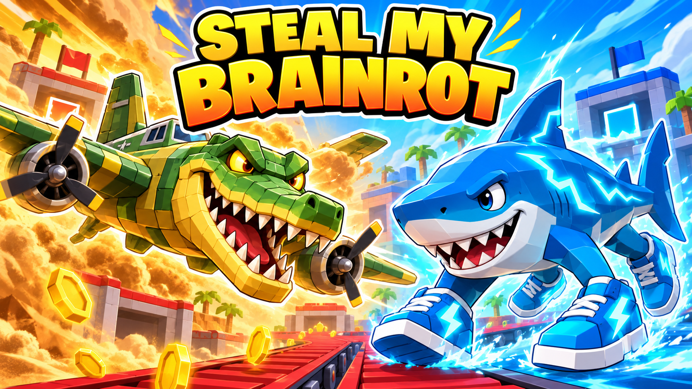
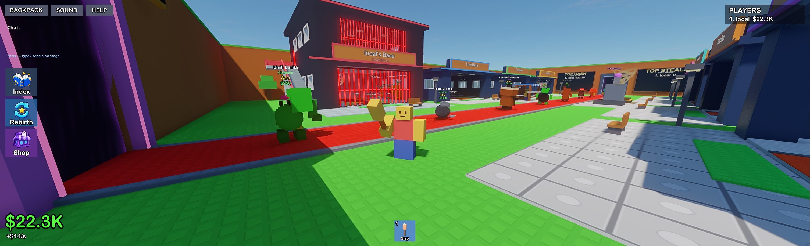
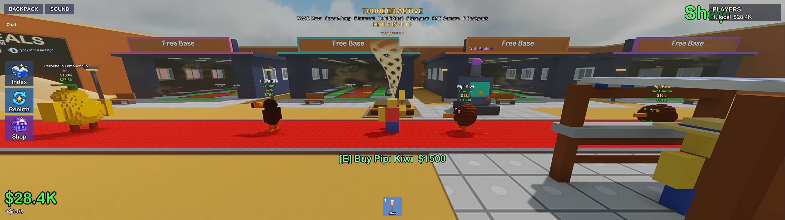
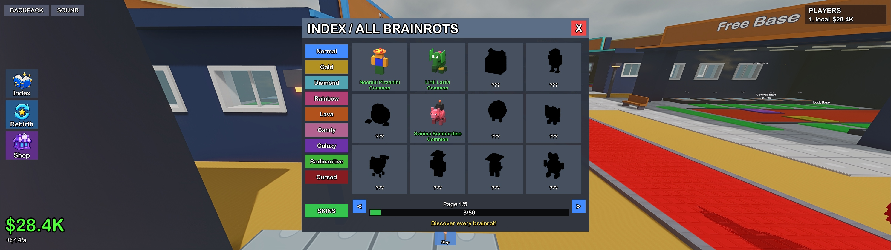
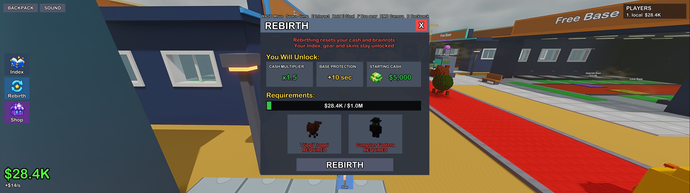
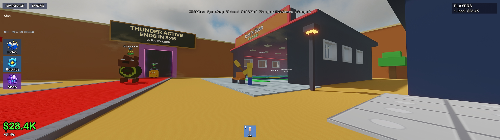
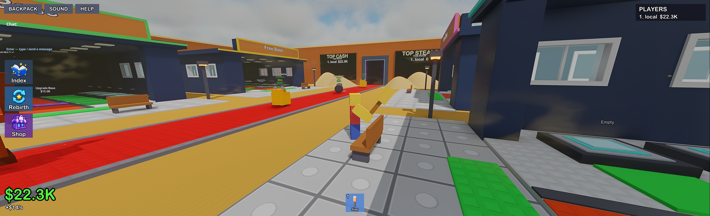

<div align="center">
<h1>Steal my Brainrot</h1>
<p><b>Build your collection. Guard your base. Steal the spotlight.</b></p>
<p>A multiplayer collection and base-defense game made with EdenSpark &amp; Daslang.</p>
<p>
<a href="https://edenspark.io/en"></a>


</p>
<p><a href="#quick-start">Quick start</a> &bull; <a href="#screenshots">Screenshots</a> &bull; <a href="#controls">Controls</a> &bull; <a href="README.ru.md">Русский</a></p>
<p>Created by <a href="https://github.com/qparkio"><b>andruw / qparkio</b></a></p>
</div>

## Your collection. Everyone else's target.

The red carpet never stops moving. Buy a brainrot before it passes, bring it home, and turn a few empty slots into a money-making collection. Then look across the arena: someone else has exactly the character you want.

Sneak into a rival's base, carry your prize back, and keep an eye on your own doors. Expand upward, unlock gear, discover mutations, and rebirth for lasting progression. When **Thunder** rolls in, the arena turns to sand and rarer characters get a bigger share of the spawn pool.

**Buy → earn → upgrade → steal → defend → rebirth.**

## Inside the game

| Collect | Build | Compete |
| :--- | :--- | :--- |
| **56** voxel characters | **3** floors and **22** base slots | Rooms configured for **up to 8 players** |
| **8** rarity tiers, Common through OG | **12** base skins | Stealing, carrying, stuns, and laser gates |
| Normal + **8** mutations | **12** rebirth levels | Live cash and steals leaderboards |
| Collection Index and three-item fusion | Passive income and cash collection pads | **11** gear items and room chat |

- **A base worth protecting.** Step onto the yellow lock pad to secure your base, including the upper-floor entrances. Upgrade for more room and new ways to show off your collection.
- **Gear with a purpose.** Slaps, speed and gravity coils, traps, a Bee Launcher, Taser, Cloak, and Boogie Bomb make every raid a little less predictable.
- **Thunder changes the mood.** A five-minute sandstorm on a thirty-minute server cycle, with a vortex, dunes, dust, warm lighting, and its own music. Rare-and-above spawn weights increase during the event.
- **Progress that stays with you.** Player profiles, collection discoveries, equipment, skins, and completed steals are saved by the server.
- **A readable, model-based UI.** The Index, shop, backpack, fusion screen, and skin collection use thumbnails of the actual game models. Master, music, effects, and voices have separate volume controls.

## Screenshots

Captured in the EdenSpark build. The illustrated cover above is promotional artwork.

<table>
<tr>
<td width="50%"><br><b>Build a collection. Defend it.</b></td>
<td width="50%"><br><b>Thunder arrives.</b></td>
</tr>
<tr>
<td><br><b>Discover all 56 characters.</b></td>
<td><br><b>Rebirth and grow.</b></td>
</tr>
<tr>
<td><br><b>Your corner of the arena.</b></td>
<td><br><b>One carpet. Eight bases.</b></td>
</tr>
</table>

## Quick start

This repository contains the **EdenSpark source project and its assets**. An EdenSpark installation is required to run it.

1. Install [EdenSpark](https://edenspark.io/en).
2. Clone the project, or use **Code → Download ZIP** and extract it:

   ```sh
   git clone https://github.com/qparkio/BrainRotEdenSpark.git
   ```

3. Open the project folder in EdenSpark: choose the directory containing `manifest.blk`, `main.das`, and `main.prefab`. If your launcher uses a local projects library, place the clone in that library.
4. Press the editor's **Play** button, then the game's **PLAY** button. Choose **Play locally** in the lobby to start a local room.
5. To try multiplayer locally, open a second EdenSpark client and join the same local room.

The client starts from `main.das`; the dedicated server uses `dedicated.das`. Keep the `assets/` directory and all `.meta` files together with the scripts.

## Controls

| Input | Action |
| :--- | :--- |
| **W A S D** | Move |
| **Space** | Jump |
| **Hold right mouse + move mouse** | Rotate the camera |
| **Arrow keys** | Rotate / tilt the camera |
| **Mouse wheel** | Zoom |
| **E** | Buy, interact, or open a sell confirmation |
| **Hold E** | Steal a rival's brainrot |
| **F / left mouse** | Use the equipped gear |
| **1–9** | Select a gear slot |
| **B** | Open the backpack |
| **Enter** | Open / send room chat |
| **Esc** | Close a game window |

Walk over your collection pads to collect cash. Step onto the yellow base pad to activate the lock.

## Explore the project

| File / folder | What's inside |
| :--- | :--- |
| [`main.das`](main.das) / [`dedicated.das`](dedicated.das) | Client and dedicated-server entry points |
| [`server_game.das`](server_game.das) | Economy, inventory, stealing, progression, and saving |
| [`brainrot_data.das`](brainrot_data.das) | Character roster, rarities, mutations, and values |
| [`world.das`](world.das) / [`models.das`](models.das) | Arena, bases, and procedural geometry |
| [`ui.das`](ui.das) | HUD, shop, collection, rebirth, fusion, skins, and help |
| `thunder_*.das` | Event clock, weather, world displays, and effects |
| [`assets/`](assets/) | Models, textures, materials, shaders, fonts, and audio |
| [`tools/`](tools/) | Blender exporters, texture/audio generators, and asset validation |

[Development guide](docs/DEVELOPMENT.md) · [Validation notes](docs/VALIDATION.md) · [Asset sources](docs/ASSETS.md)

## Author

**andruw** — game creator and developer. [GitHub: qparkio](https://github.com/qparkio) · [Telegram](https://t.me/andruwrus)

An independent fan project inspired by the brainrot collecting genre. The EdenSpark project is developed by andruw; third-party sounds, fonts, and branding retain their own terms, documented in [asset sources](docs/ASSETS.md). See [LICENSE](LICENSE) for the project notice.
